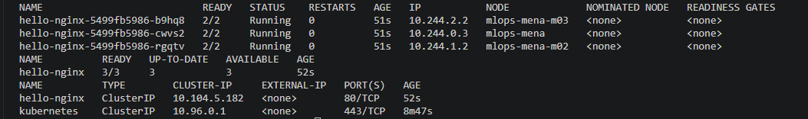
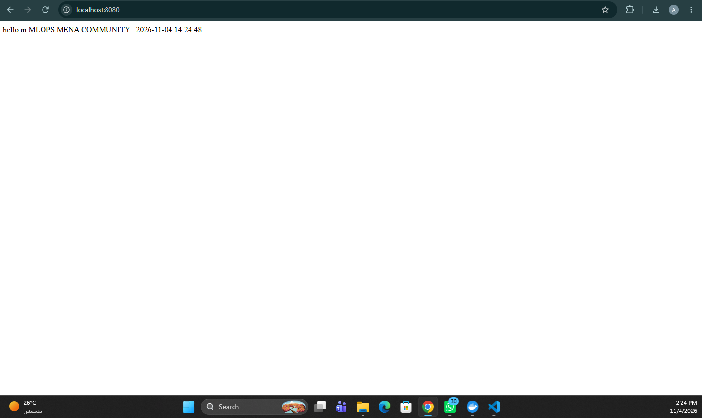
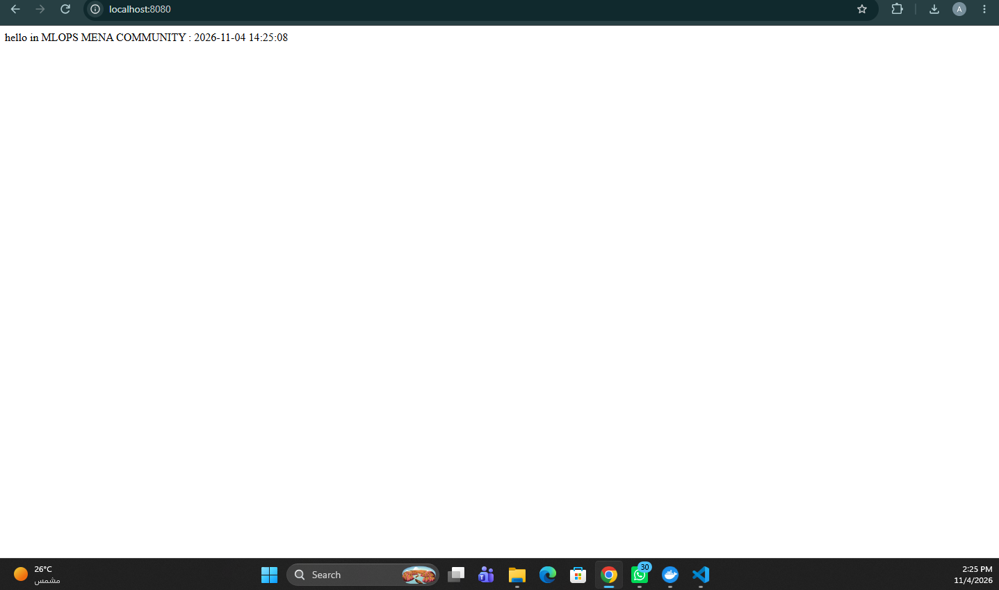
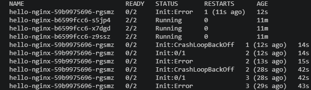
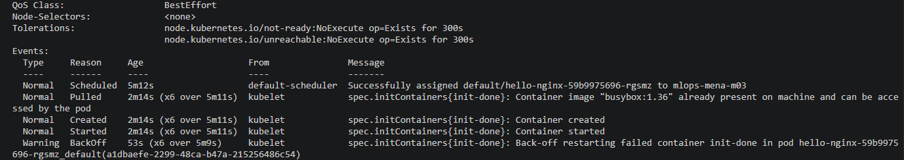
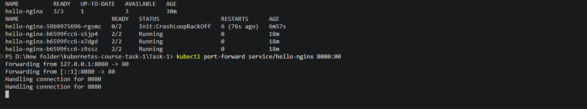
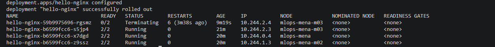

# Task 1: Multi-container Pods (Init Container & Sidecar)

## Objective

Deploy an Nginx Hello page on a three-node Minikube cluster. Each Pod contains a successful `init-done` init container, an `nginx` application container, and a `time-updater` sidecar. The Pod uses `shareProcessNamespace: true` and no volumes. The sidecar updates Nginx's `index.html` every five seconds through `/proc/<pid>/root`.

Expected page format:

```text
hello in MLOPS MENA COMMUNITY : 2026-10-15 10:15:05
```

The manifests use `TZ=EET-2` for a fixed UTC+2 offset, matching Egypt's standard time in November 2026.

## Repository structure

```text
Task-1/
├── README.md
├── deployment.yaml
├── deployment-failing.yaml
├── service.yaml
└── screenshots/
    ├── 01-cluster-pods.png
    ├── 02-first-timestamp.png
    ├── 03-updated-timestamp.png
    ├── 04-init-failure.png
    ├── 05-failure-diagnosis.png
    ├── 06-availability.png
    └── 07-recovery.png
```

## Environment

Windows PowerShell, Docker Desktop with Linux containers, Minikube, and kubectl.

```powershell
minikube start --profile mlops-mena --driver=docker --nodes=3
kubectl config use-context mlops-mena
kubectl get nodes -o wide
```

## Deploy the healthy application

Run from the repository root (the directory containing `Task-1`):

```powershell
kubectl apply -f Task-1/deployment.yaml
kubectl apply -f Task-1/service.yaml
kubectl rollout status deployment/hello-nginx --timeout=180s
kubectl get pods -l app=hello-nginx -o wide
kubectl get deployment hello-nginx
```

All three Pods should be ready and show `2/2 Running`. The init container exits successfully and is not included in the `2/2` count.



## Verify initialization and process sharing

Choose a healthy Pod name from `kubectl get pods` and replace `POD_NAME`:

```powershell
kubectl logs POD_NAME -c init-done
kubectl exec POD_NAME -c time-updater -- ps
kubectl exec POD_NAME -c time-updater -- sh -c 'pid=$(pgrep -o nginx); cat "/proc/$pid/root/usr/share/nginx/html/index.html"'
```

The init container log should contain `done`. The sidecar should see the Nginx process and read the web page through `/proc/<pid>/root`. Neither Deployment manifest declares volumes.

## Verify timestamp updates

In terminal A, keep the port-forward running:

```powershell
kubectl port-forward service/hello-nginx 8080:80
```

In terminal B:

```powershell
curl.exe -s http://localhost:8080/
Start-Sleep -Seconds 6
curl.exe -s http://localhost:8080/
```

The timestamp should advance between requests as the sidecar updates `index.html` every five seconds.





## Intentionally fail the init container

```powershell
kubectl apply -f Task-1/deployment-failing.yaml
kubectl get pods -l app=hello-nginx -o wide
kubectl get replicasets -l app=hello-nginx
```

The new revision's `init-done` prints `done` and exits with code `1`. After repeated retries, its new Pod should display `Init:CrashLoopBackOff`. The three previous healthy Pods should stay `2/2 Running`, because the Deployment uses `maxSurge: 1` and `maxUnavailable: 0`.



## Diagnose the failure

Replace `FAILING_POD_NAME` with the failing Pod's name:

```powershell
kubectl describe pod FAILING_POD_NAME
kubectl logs FAILING_POD_NAME -c init-done --previous
kubectl describe deployment hello-nginx
```

The Pod description should report a terminated init container with exit code `1`, nonzero restart counts, and back-off events. A log containing `done` does not indicate success: the process exit status controls success.



## Verify availability during the broken rollout

```powershell
kubectl get deployment hello-nginx
kubectl get endpointslices -l kubernetes.io/service-name=hello-nginx -o yaml
curl.exe -s http://localhost:8080/
Start-Sleep -Seconds 6
curl.exe -s http://localhost:8080/
```

Check that the three old Pods remain Ready, and Service EndpointSlice conditions reflect ready backends. The page should continue responding while the new Pod fails. This is a local availability check rather than a production-grade zero-downtime measurement.

If the existing port-forward has ended, restart it before the HTTP checks:

```powershell
kubectl port-forward service/hello-nginx 8080:80
```



## Recover the Deployment

```powershell
kubectl apply -f Task-1/deployment.yaml
kubectl rollout status deployment/hello-nginx --timeout=180s
kubectl get pods -l app=hello-nginx -o wide
kubectl get deployment hello-nginx
curl.exe -s http://localhost:8080/
```

The failing revision should be removed and the three healthy Pods should remain or return to `2/2 Running`. Confirm the page is accessible and its timestamp continues to update.



## Key results

- `init-done` must exit successfully before Nginx and the updater start.
- `nginx` serves the initial timestamp on port 80.
- `time-updater` changes the timestamp every five seconds through `/proc/<pid>/root` without volumes.
- An init container exiting with code `1` prevents the new Pod from becoming Ready.
- During a failed rolling update, the three previously healthy Pods remain available with `maxUnavailable: 0`.
- Restoring the working manifest resolves the failed rollout.

## Cleanup (optional, after grading)

```powershell
kubectl delete -f Task-1/service.yaml
kubectl delete -f Task-1/deployment.yaml
minikube stop --profile mlops-mena
```
