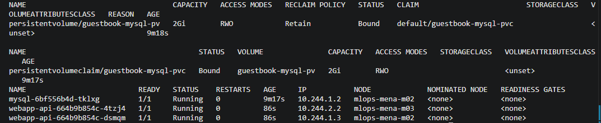
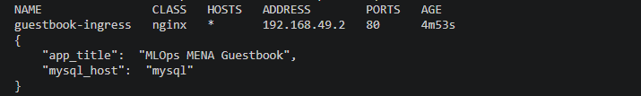
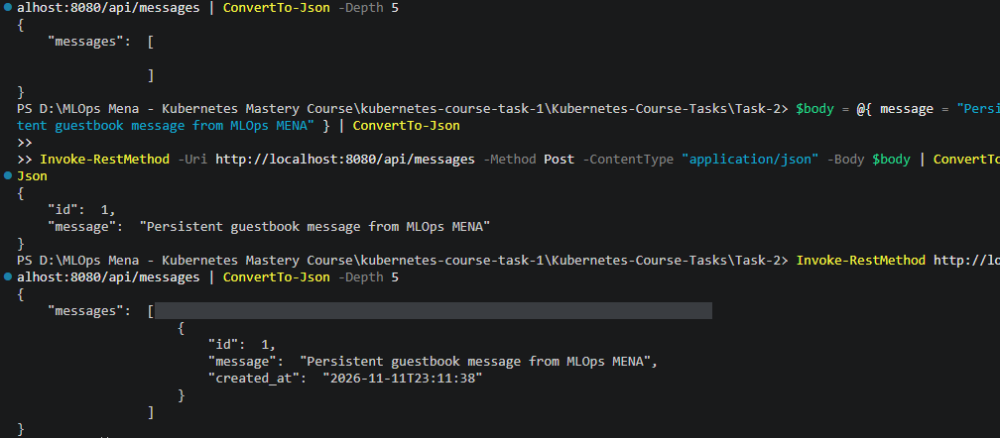
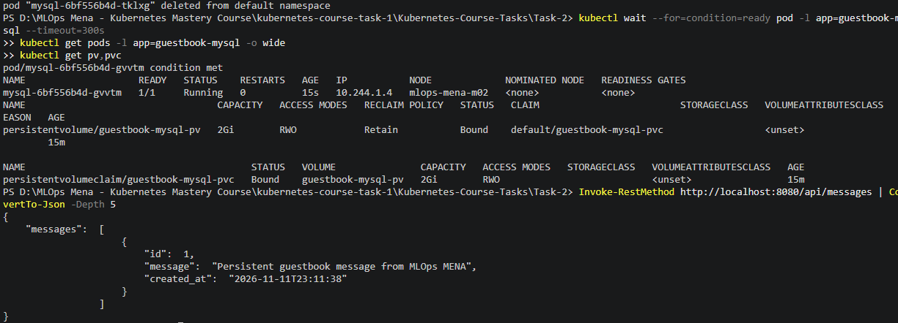

# Task Session 2: FastAPI + MySQL with ConfigMap, Secret & Ingress

## Overview

A two-replica FastAPI guestbook backed by MySQL. An NGINX Ingress routes `/` to the API Service, a ConfigMap stores non-sensitive application settings, and a Kubernetes Secret provides the database credentials. MySQL uses a 2Gi static `hostPath` PersistentVolume and matching PersistentVolumeClaim.

## Architecture

```text
Client
  |
NGINX Ingress (/) 
  |
webapp-api Service (80)
  |
webapp-api Deployment (2 replicas, port 8000)
  |
mysql Service (3306)
  |
mysql Deployment (1 replica, minikube second node)
  |
guestbook-mysql-pvc (2Gi, Bound)
  |
guestbook-mysql-pv (hostPath, Retain, node affinity)
```

- `webapp-config` defines `APP_TITLE` and `MYSQL_HOST`.
- `mysql-secret` supplies `MYSQL_ROOT_PASSWORD`, `MYSQL_USER`, `MYSQL_PASSWORD`, and `MYSQL_DATABASE`.
- The MySQL data directory is mounted from the PVC at `/var/lib/mysql`.
- The PV is statically bound and has `storageClassName: ""` to avoid Minikube's default dynamic provisioner.
- The persistent directory is node-local. A Pod restart retains data; deleting the node or cluster may not.

## Prerequisites

Windows PowerShell, Docker Desktop, Minikube, kubectl, and the existing three-node Minikube profile named `mlops-mena`.

The original assignment mentions `minikube-m02`. This project uses the existing profile's equivalent worker node, `mlops-mena-m02`. Check the hostname label before applying manifests. If the second node has another hostname, change only `spec.nodeAffinity.required.nodeSelectorTerms[0].matchExpressions[0].values` in `01-mysql-pv.yaml` before creating the PV.

## Start and inspect the cluster

From the repository root:

```powershell
minikube start -p mlops-mena
kubectl config use-context mlops-mena
kubectl get nodes -L kubernetes.io/hostname
```

There must be three Ready nodes. The hostname label for the second worker node must match the PV manifest.

## Build the FastAPI image on all three nodes

```powershell
minikube -p mlops-mena image build --all -t guestbook-api:session2 Task-2/app
```

The image is local to Minikube and the deployment uses `imagePullPolicy: Never`. Rebuild it on all nodes after changing the application code.

## Create the MySQL Secret

Create the Secret in the cluster. Never commit real passwords or a generated Secret YAML file to GitHub.

```powershell
$rootPassword = "root-" + [guid]::NewGuid().ToString("N")
$appPassword = "app-" + [guid]::NewGuid().ToString("N")
kubectl create secret generic mysql-secret --from-literal="MYSQL_ROOT_PASSWORD=$rootPassword" --from-literal="MYSQL_USER=guestbook" --from-literal="MYSQL_PASSWORD=$appPassword" --from-literal="MYSQL_DATABASE=guestbook"
Remove-Variable rootPassword, appPassword
kubectl get secret mysql-secret
```

Create this Secret only once for a given initialized MySQL volume. Changing its values without also updating the existing MySQL user credentials can prevent the application from connecting.

## Enable NGINX Ingress

```powershell
minikube -p mlops-mena addons enable ingress
kubectl get pods -n ingress-nginx
```

Confirm the ingress controller is Running and Ready before testing. Windows Docker-driver clusters may require additional configuration for the addon; direct access to the Minikube node IP is not generally available from Windows.

## Deploy Kubernetes resources

```powershell
kubectl apply -f Task-2/manifests/01-mysql-pv.yaml
kubectl apply -f Task-2/manifests/02-mysql-pvc.yaml
kubectl apply -f Task-2/manifests/03-webapp-config.yaml
kubectl apply -f Task-2/manifests/04-mysql.yaml
kubectl rollout status deployment/mysql --timeout=300s
kubectl apply -f Task-2/manifests/05-webapp-api.yaml
kubectl rollout status deployment/webapp-api --timeout=300s
kubectl apply -f Task-2/manifests/06-ingress.yaml
kubectl get pv,pvc
kubectl get deployments,pods,services,ingress -o wide
```

Expected: `guestbook-mysql-pv` and `guestbook-mysql-pvc` are `Bound`, MySQL is Ready on `mlops-mena-m02`, and the two API Pods are Ready.

## Test through NGINX Ingress

On Windows with the Docker driver, the most reliable way to test HTTP routing through NGINX is to forward a local port to the **Ingress controller Service**, not directly to the API Service.

Stop the Session 1 port-forward first if it is still using local port 8080 (`Ctrl+C` in that terminal). Keep the following command running in its own PowerShell terminal:

```powershell
kubectl -n ingress-nginx port-forward service/ingress-nginx-controller 8080:80
```

In a second PowerShell terminal:

```powershell
Invoke-RestMethod http://localhost:8080/api/info | ConvertTo-Json
Invoke-RestMethod http://localhost:8080/api/messages | ConvertTo-Json -Depth 5
```

Expected `/api/info`: `app_title` and `mysql_host`. Expected initial `/api/messages`: `{"messages":[]}`.

Create a message, then read it back:

```powershell
$body = @{ message = "Persistent guestbook message from MLOps MENA" } | ConvertTo-Json
Invoke-RestMethod -Uri http://localhost:8080/api/messages -Method Post -ContentType "application/json" -Body $body | ConvertTo-Json
Invoke-RestMethod http://localhost:8080/api/messages | ConvertTo-Json -Depth 5
```

Record the assigned ID and message text before restarting MySQL.

## Prove persistence after deleting the MySQL Pod

In a PowerShell terminal separate from the port-forward process:

```powershell
kubectl get pods -l app=guestbook-mysql -o wide
kubectl delete pod -l app=guestbook-mysql
kubectl rollout status deployment/mysql --timeout=300s
kubectl get pods -l app=guestbook-mysql -o wide
kubectl get pv,pvc
Invoke-RestMethod http://localhost:8080/api/messages | ConvertTo-Json -Depth 5
```

The deleted Pod is replaced by a newly named MySQL Pod on the same second node, and the message previously inserted must still be present with the same ID. If the API becomes temporarily unavailable during MySQL restart, run the final GET after MySQL is Ready and the API's readiness checks recover.

## Evidence

Save real screenshots from your cluster in `Task-2/screenshots/`:

1. `01-pv-pvc-and-pods.png` — PV/PVC Bound, MySQL pinned to the second node, and two FastAPI Pods running.
2. `02-ingress-info.png` — Ingress resource, local ingress-controller port-forward, and successful `/api/info` request.
3. `03-messages-before-restart.png` — Successful POST and GET at `/api/messages`, showing the new message and ID.
4. `04-persistence-after-restart.png` — Deleted/recreated MySQL Pod and the same message and ID still returned afterward.

### Storage and application status



### Ingress access



### Messages before restart



### Messages after restart



## Troubleshooting

```powershell
kubectl describe pvc guestbook-mysql-pvc
kubectl describe pv guestbook-mysql-pv
kubectl describe pod -l app=guestbook-mysql
kubectl logs deployment/mysql
kubectl logs deployment/webapp-api
kubectl describe ingress guestbook-ingress
kubectl get pods -n ingress-nginx
```

- `PVC Pending`: verify both PV and PVC use `storageClassName: ""`, match 2Gi, and the PV was not previously bound to another PVC.
- `MySQL Pending`: verify the node affinity target matches the second node's actual hostname label.
- `ImagePullBackOff` or `ErrImageNeverPull`: build the API image on all nodes using the Minikube command above.
- `webapp-api` not Ready: check the MySQL Pod and database credentials in `mysql-secret`.
- `404` at `localhost:8080`: verify the NGINX Ingress controller and `guestbook-ingress` resource are present, and that the port-forward targets the Ingress controller Service rather than the API Service.

## Notes

This is a local educational deployment. MySQL has a single replica, so writes can be temporarily unavailable when its Pod is deleted. The goal is **data persistence**, not zero database downtime. The application image exists only in the local Minikube cluster; a public container registry is not needed for this exercise.
