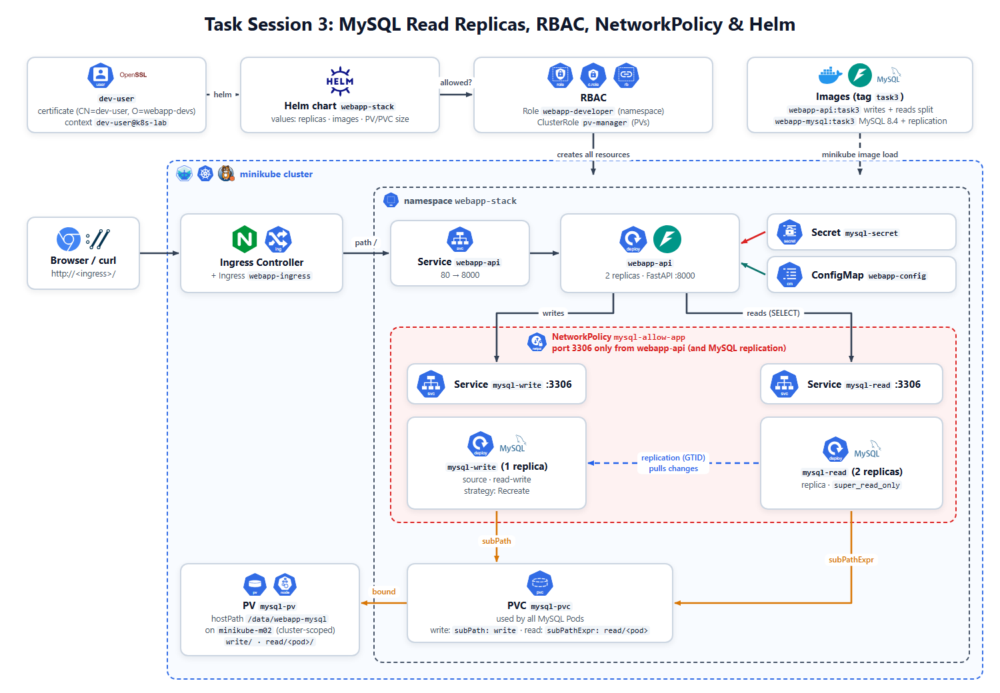
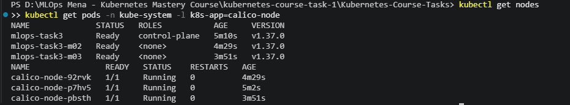
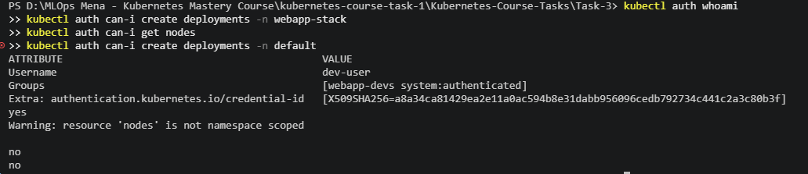
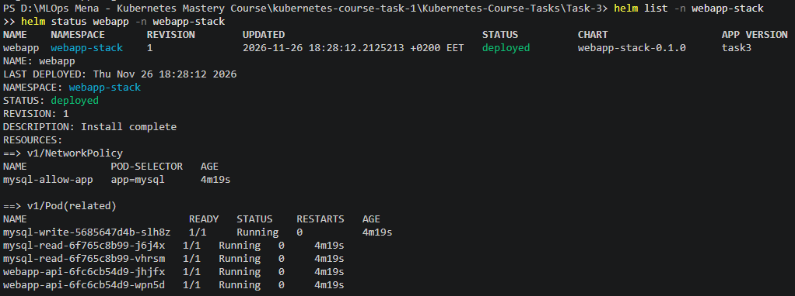
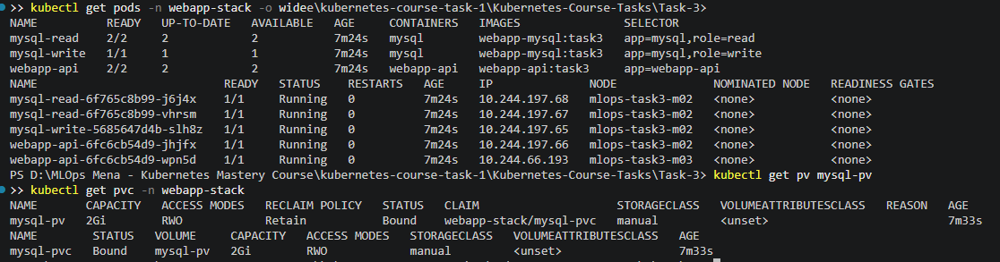
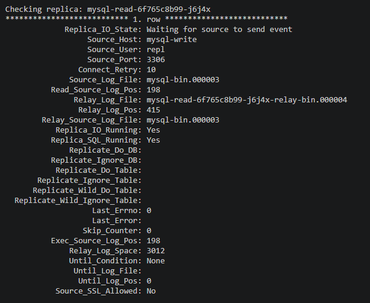
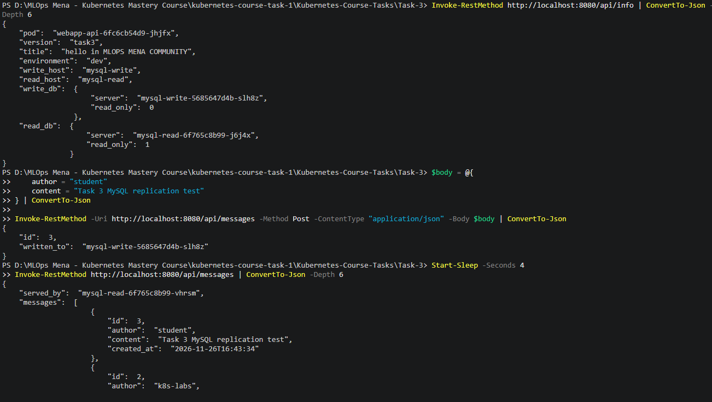
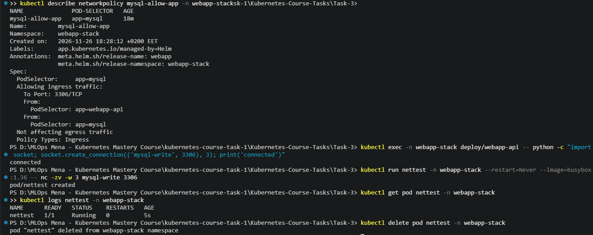
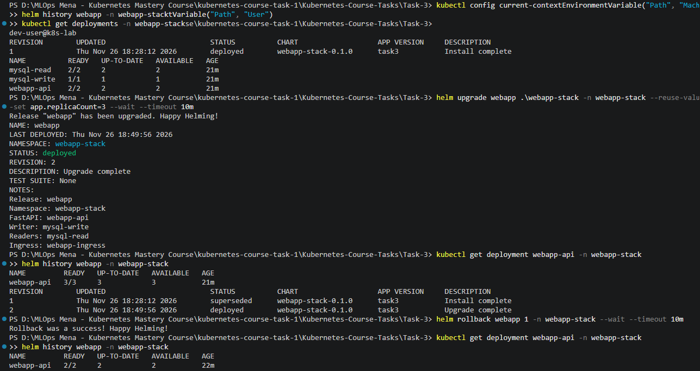

# Task 3 & 4 — MySQL Replication, RBAC, NetworkPolicy and Helm

MLOps MENA Kubernetes Mastery Course. This submission follows the provided `task-session-3` starter implementation, keeping its FastAPI routes and MySQL GTID replication logic. Application and Docker configuration files have no explanatory code comments.

## Architecture



- Namespace: `webapp-stack`
- Identity: certificate-authenticated `dev-user`, group `webapp-devs`
- Web: two `webapp-api:task3` FastAPI replicas, Service `webapp-api`, and `webapp-ingress`
- Databases: one `mysql-write` and two `mysql-read` replicas, all using `webapp-mysql:task3`
- Storage: `mysql-pv` and `mysql-pvc`, 2Gi `hostPath` on the second Minikube node
- Database directories: `write/` for the source and `read/<pod-name>/` for the two replicas
- Configuration: `webapp-config` with `MYSQL_WRITE_HOST` and `MYSQL_READ_HOST`
- Credentials: `mysql-secret` generated by the chart from an untracked local Helm values file
- Access control: `webapp-developer` Role and binding, with a `pv-manager` ClusterRole exception for PV creation
- Networking: `mysql-allow-app` permits MySQL connections from FastAPI Pods and other MySQL Pods only
- Packaging: one Helm chart, `webapp-stack`, release `webapp`

### Repository layout

```text
Task-3/
├── README.md
├── .gitignore
├── images/
├── webapp/
│   ├── Dockerfile
│   ├── requirements.txt
│   └── app/
├── mysql/
│   ├── Dockerfile
│   ├── conf/
│   ├── initdb/
│   └── schema/
├── rbac/
│   ├── 01-namespace.yaml
│   ├── 02-role.yaml
│   ├── 03-rolebinding.yaml
│   ├── 04-pv-clusterrole.yaml
│   └── 05-pv-clusterrolebinding.yaml
├── webapp-stack/
│   ├── Chart.yaml
│   ├── values.yaml
│   └── templates/
└── screenshots/
```

This chart creates the Secret, ConfigMap, PV, PVC, three Deployments, three Services, Ingress, and NetworkPolicy. The namespace and RBAC objects are **admin prerequisites**, outside the Helm chart, because creating the `dev-user` identity and its permissions is an administrative operation. The Helm installation itself runs as `dev-user`.

## Windows PowerShell walkthrough

All paths below assume PowerShell is opened **inside `Task-3`** in the existing `Kubernetes-Course-Tasks` repository. Use two PowerShell windows when running port-forward and API tests.

### 1. Check tools and cluster

```powershell
minikube version
kubectl version --client
helm version
docker --version
kubectl config current-context
kubectl get nodes -L kubernetes.io/hostname
kubectl get pods -n kube-system -l k8s-app=calico-node
kubectl get pods -n ingress-nginx
```

Install Helm if missing:

```powershell
winget install --id Helm.Helm -e
```

Restart PowerShell after installation.

**Calico is required for the NetworkPolicy test.** If the Calico query returns no Pods, do not interpret a created NetworkPolicy as enforced. The safest course-lab method is to preserve the existing Task 2 profile, stop it, and create a separate three-node Calico profile. This avoids deleting Task 2 Kubernetes resources or GitHub files:

```powershell
minikube stop -p mlops-mena
minikube start -p mlops-task3 --driver=docker --nodes=3 --cni=calico --memory=2048 --cpus=2
minikube -p mlops-task3 addons enable ingress
kubectl config use-context mlops-task3
kubectl get nodes
kubectl get pods -n kube-system -l k8s-app=calico-node
kubectl wait -n ingress-nginx --for=condition=ready pod -l app.kubernetes.io/component=controller --timeout=300s
```

Run these only if the current cluster lacks policy enforcement. With roughly 8GiB available to Docker, **do not run both three-node profiles at once**. If the original profile already uses Calico and is healthy, use it instead. Do not switch profiles in the middle of the procedure.

Choose the active profile for the following steps:

```powershell
$clusterProfile = (kubectl config current-context)
$nodeName = "$clusterProfile-m02"
kubectl get node $nodeName
```

If an existing Task 2 Ingress has the same hostless `/` route in the **same cluster**, the two Ingresses may conflict. On the original `mlops-mena` profile, verify which Ingresses exist with `kubectl get ingress -A` and remove only the conflicting old Task 2 Ingress after confirming that its original evidence is complete. This issue does not apply to a separate `mlops-task3` cluster.

### 2. Build the supplied new images

```powershell
docker build -t webapp-api:task3 .\webapp
docker build -t webapp-mysql:task3 .\mysql
minikube -p $clusterProfile image load webapp-api:task3
minikube -p $clusterProfile image load webapp-mysql:task3
minikube -p $clusterProfile image ls | Select-String 'webapp-api|webapp-mysql'
```

Both images must be present on the three-node Minikube cluster. Do not overwrite Task 2 image tags.

### 3. Prepare the namespace and RBAC as administrator

```powershell
kubectl apply -f .\rbac\01-namespace.yaml
kubectl apply -f .\rbac\02-role.yaml
kubectl apply -f .\rbac\03-rolebinding.yaml
kubectl apply -f .\rbac\04-pv-clusterrole.yaml
kubectl apply -f .\rbac\05-pv-clusterrolebinding.yaml
```

Verify the RBAC rules using impersonation:

```powershell
kubectl auth can-i create deployments -n webapp-stack --as=dev-user
kubectl auth can-i create persistentvolumes --as=dev-user
kubectl auth can-i get nodes --as=dev-user
kubectl auth can-i create deployments -n default --as=dev-user
```

Expected answers are `yes`, `yes`, `no`, `no`. PersistentVolumes are cluster-scoped; `pv-manager` is the **explicit exception** to the assignment's namespace-only wording. Its `*` permissions apply to PersistentVolumes only, not Nodes or other cluster resources.

### 4. Create the real `dev-user` certificate

On Windows, OpenSSL can be accessed through Git for Windows (often `C:\Program Files\Git\usr\bin\openssl.exe`) or another installed OpenSSL binary. Check `openssl version` first. These examples use `openssl` on `PATH`. If it is not recognized, run `& "C:\Program Files\Git\usr\bin\openssl.exe" version` to check the OpenSSL bundled with Git for Windows, and call that executable with `&` instead of `openssl` in the commands below.

```powershell
New-Item -ItemType Directory -Force .\identity | Out-Null
openssl genrsa -out .\identity\dev-user.key 2048
openssl req -new -key .\identity\dev-user.key -out .\identity\dev-user.csr -subj '/CN=dev-user/O=webapp-devs'
$encodedCsr = [Convert]::ToBase64String([IO.File]::ReadAllBytes((Resolve-Path .\identity\dev-user.csr).Path))
@"
apiVersion: certificates.k8s.io/v1
kind: CertificateSigningRequest
metadata:
  name: dev-user
spec:
  request: $encodedCsr
  signerName: kubernetes.io/kube-apiserver-client
  expirationSeconds: 604800
  usages:
    - client auth
"@ | kubectl apply -f -
kubectl certificate approve dev-user
kubectl get csr dev-user
$certificate = kubectl get csr dev-user -o jsonpath='{.status.certificate}'
[IO.File]::WriteAllBytes((Join-Path (Resolve-Path .\identity).Path 'dev-user.crt'), [Convert]::FromBase64String($certificate))
```

The certificate is issued by Kubernetes' signer, authenticating the user `dev-user` in the group `webapp-devs`. The `identity/` folder is ignored by Git; never upload `dev-user.key`, certificates, or user-specific kubeconfig files.

Configure the user context (while the current context is still the cluster administrator):

```powershell
$server = kubectl config view --minify -o jsonpath='{.clusters[0].cluster.server}'
$caPath = Join-Path $env:USERPROFILE '.minikube\ca.crt'
$certificatePath = (Resolve-Path .\identity\dev-user.crt).Path
$keyPath = (Resolve-Path .\identity\dev-user.key).Path
kubectl config set-cluster k8s-lab --server="$server" --certificate-authority="$caPath" --embed-certs=true
kubectl config set-credentials dev-user --client-certificate="$certificatePath" --client-key="$keyPath" --embed-certs=true
kubectl config set-context dev-user@k8s-lab --cluster=k8s-lab --user=dev-user --namespace=webapp-stack
kubectl config use-context dev-user@k8s-lab
kubectl auth whoami
kubectl auth can-i create deployments -n webapp-stack
kubectl auth can-i get nodes
```

Expected identity is `dev-user`, group `webapp-devs`; creation of Deployments in `webapp-stack` is allowed while reading Nodes is forbidden. Keep `$clusterProfile` and `$nodeName` from Step 1 in the same PowerShell session; reassign them if opening a new terminal.

### 5. Generate local Helm credentials and validate the chart

The tracked `values.yaml` deliberately contains **no passwords**. Generate strong, lab-only credentials in the ignored `values.local.yaml` file:

```powershell
$rootPassword = [guid]::NewGuid().ToString('N')
$appPassword = [guid]::NewGuid().ToString('N')
$replicationPassword = [guid]::NewGuid().ToString('N')
@"
mysql:
  auth:
    rootPassword: "$rootPassword"
    appPassword: "$appPassword"
    replicationPassword: "$replicationPassword"
storage:
  nodeName: "$nodeName"
"@ | Set-Content -Encoding utf8 .\values.local.yaml
Remove-Variable rootPassword, appPassword, replicationPassword
helm lint .\webapp-stack -f .\values.local.yaml
helm template webapp .\webapp-stack -n webapp-stack -f .\values.local.yaml > $null
```

Keep this file unchanged between upgrades, rollbacks, and Pod restarts; the MySQL data and the passwords must match. Do not paste or screenshot Secret contents, `helm template` output containing the Secret, or the contents of `values.local.yaml`.

### 6. Install as `dev-user`

**Do not run `kubectl apply -f webapp-stack/templates`.** Helm alone creates and owns its templated objects.

```powershell
kubectl config current-context
helm install webapp .\webapp-stack --namespace webapp-stack -f .\values.local.yaml --wait --timeout 10m
helm list -n webapp-stack
helm status webapp -n webapp-stack
kubectl get deploy,svc,pvc,configmap,secret,ingress,networkpolicy -n webapp-stack
kubectl get pv mysql-pv
kubectl get pods -n webapp-stack -o wide
```

Expected result: `helm list` reports `webapp` deployed; `webapp-api` is `2/2`, `mysql-write` is `1/1`, `mysql-read` is `2/2`, PV/PVC are `Bound`, and all three MySQL Pods are on `$nodeName`. Initial MySQL startup and replication can require retries.

### 7. Verify both read replicas

```powershell
$readPods = (kubectl get pods -n webapp-stack -l 'app=mysql,role=read' -o jsonpath='{.items[*].metadata.name}') -split ' '
foreach ($pod in $readPods) {
    Write-Host $pod
    kubectl exec -n webapp-stack $pod -- sh -c 'mysql -uroot -p"$MYSQL_ROOT_PASSWORD" -e "SHOW REPLICA STATUS\G"'
}
```

Each replica must report `Replica_IO_Running: Yes` and `Replica_SQL_Running: Yes`. The replicas should have distinct server IDs and data directories. As an administrator, you can inspect the node-local directories without changing anything:

```powershell
minikube -p $clusterProfile ssh -n $nodeName -- ls -la /data/webapp-mysql/read
```

To verify the server is read-only:

```powershell
kubectl exec -n webapp-stack $readPods[0] -- sh -c 'mysql -uroot -p"$MYSQL_ROOT_PASSWORD" -e "SELECT @@super_read_only;"'
```

Expected `@@super_read_only = 1`. Do not disable read-only mode.

### 8. Test both APIs through NGINX Ingress

Run a port-forward from a **new admin PowerShell terminal**. The dev-user cannot manage objects in `ingress-nginx`.

```powershell
kubectl --context $clusterProfile port-forward -n ingress-nginx svc/ingress-nginx-controller 8080:80
```

In the original `Task-3` terminal:

```powershell
Invoke-RestMethod http://localhost:8080/api/info | ConvertTo-Json -Depth 6
$body = @{author='student'; content='Task 3 write and read replication verified'} | ConvertTo-Json
Invoke-RestMethod -Uri http://localhost:8080/api/messages -Method Post -ContentType application/json -Body $body | ConvertTo-Json
Start-Sleep -Seconds 4
Invoke-RestMethod http://localhost:8080/api/messages | ConvertTo-Json -Depth 6
```

Expected `/api/info` includes `version: task3`, `write_host: mysql-write`, `read_host: mysql-read`, `write_db.read_only: 0`, and `read_db.read_only: 1`. POST should show `written_to: mysql-write-...`; GET should return the message and `served_by: mysql-read-...`.

Replication is asynchronous: if the GET response initially doesn't contain a freshly posted message, repeat the GET shortly afterward. Test both readers by repeating reads or checking both replicas directly.

### 9. Verify NetworkPolicy enforcement

From the `dev-user` terminal, prove the app can connect to MySQL:

```powershell
kubectl exec -n webapp-stack deploy/webapp-api -- python -c "import socket; socket.create_connection(('mysql-write', 3306), 3); print('connected')"
```

Then prove an unrelated Pod cannot connect:

```powershell
kubectl run nettest -n webapp-stack --restart=Never --image=busybox:1.36 -- nc -zv -w 3 mysql-write 3306
kubectl wait -n webapp-stack --for=jsonpath='{.status.phase}'=Failed pod/nettest --timeout=120s
kubectl logs -n webapp-stack nettest
kubectl delete pod nettest -n webapp-stack
```

The unlabelled `nettest` Pod should fail or time out. If it connects successfully, the cluster likely isn't enforcing the NetworkPolicy; check Calico before collecting screenshots.

### 10. Demonstrate a Helm upgrade and rollback

```powershell
helm upgrade webapp .\webapp-stack -n webapp-stack --reuse-values --set app.replicaCount=3 --wait --timeout 10m
kubectl get deploy webapp-api -n webapp-stack
helm history webapp -n webapp-stack
helm rollback webapp 1 -n webapp-stack --wait --timeout 10m
kubectl get deploy webapp-api -n webapp-stack
```

Expected app replica counts: `3/3` after upgrade and `2/2` after rollback. Persistent MySQL data stays in the PVC. **Do not uninstall** the Helm release until all verification screenshots have been captured.

## Screenshot evidence

Capture actual results from your cluster. Screenshots aren't included because they must demonstrate your own Kubernetes execution.

| File | What it must show |
|---|---|
| `01-cluster-calico.png` | Three Ready nodes and Calico running |
| `02-dev-user-rbac.png` | `kubectl auth whoami`, allowed actions in `webapp-stack`, forbidden `get nodes` |
| `03-helm-release.png` | `helm list`, `helm status`, Deployment replica counts |
| `04-storage-and-pods.png` | Bound 2Gi PV/PVC, one writer and two readers on second node |
| `05-replication-status.png` | Both readers reporting `Replica_IO_Running: Yes` and `Replica_SQL_Running: Yes` |
| `06-ingress-api.png` | `/api/info` routing and GET/POST `/api/messages` showing read/write separation |
| `07-network-policy.png` | Application reaches MySQL; unrelated Pod connection fails |
| `08-helm-upgrade.png` | App scaled to 3 with Helm and restored to 2 using rollback |

### 01 — Cluster and Calico



### 02 — Certificate identity and RBAC



### 03 — Helm release



### 04 — Persistent storage and MySQL placement



### 05 — MySQL replication



### 06 — Ingress and API verification



### 07 — Enforced NetworkPolicy



### 08 — Helm upgrade and rollback



## Notes

- This uses course-lab `hostPath` storage. It is **not** production-grade multi-node storage. PV `ReadWriteOnce` permits these Pods to share the volume only because they're pinned to one node and each uses a distinct MySQL data directory.
- Kubernetes' PV is cluster-scoped, so the official task allows `pv-manager` as an explicit cluster-level RBAC exception for `dev-user`.
- The source code is supplied by the MLOps MENA course and retains its request/response behavior. MySQL 8.4's initialization script is kept non-executable so the upstream Docker entrypoint sources it.
- `mysql-secret` stores credentials in Kubernetes; they are not encrypted merely because they're represented in Kubernetes Secret objects. For this course, do not place their plaintext or `values.local.yaml` in the public GitHub repository.
- Image tags `task3` are local Minikube images. Rebuild and reload them if you recreate the cluster.
- Helm's chart templates are the sole source of application resources. `rbac/` contains only administrator-managed namespace and access setup.
